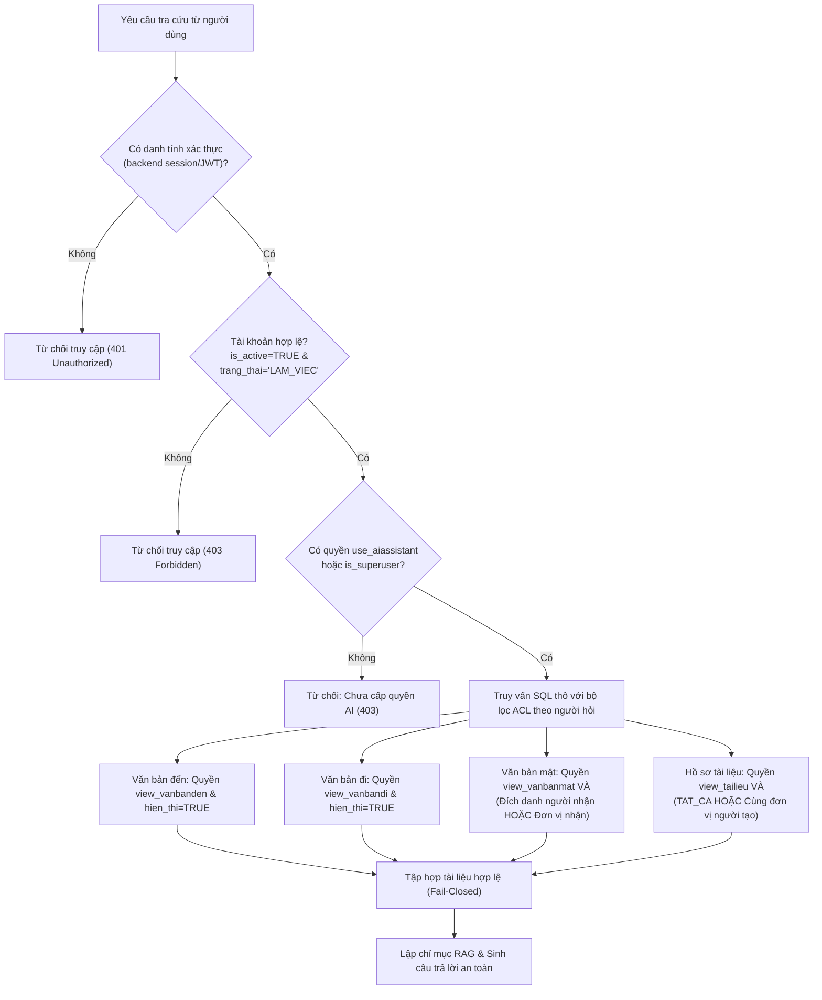

# Tài liệu Tích hợp CSDL QLVB: Truy vấn SQL thô, Tài khoản chỉ đọc & Phân quyền bảo mật

Tài liệu này được lập cho module **AI Chatbox** (nhánh `8_ai_chatbox`) thuộc hệ thống **Quản lý Văn bản TLBM (QLVB)** nhằm chuẩn hóa kiến trúc truy vấn dữ liệu SQL thô, đảm bảo an toàn cơ sở dữ liệu với tài khoản chỉ đọc, và kiểm soát truy cập nghiêm ngặt tránh lộ lọt văn bản mật.

---

## 1. Bối cảnh & Lý do thiết kế (Background & Rationale)

### 1.1. Hiện trạng: Không dùng Django Model (Raw SQL Architecture)
Hệ thống Quản lý Văn bản TLBM đã có sẵn cơ sở dữ liệu PostgreSQL chuẩn hóa với cấu trúc DDL và migrations được quản lý độc lập bởi các module nghiệp vụ cốt lõi (nhánh 1–7). 

Module **AI Chatbox** lựa chọn giải pháp **truy vấn SQL thô (Raw SQL qua cursor)** thay vì định nghĩa lại Django ORM Models vì các lý do:
- **Độc lập migration**: Tránh xung đột schema và migrations giữa module AI Chatbox và hệ thống core QLVB.
- **Tối ưu hiệu năng truy vấn**: Cho phép viết các câu truy vấn phức tạp kết hợp kiểm tra phân quyền (ACL EXISTS, array aggregation quyền) trong một lượt truy vấn duy nhất.
- **Tính di động**: Module AI Chatbox có thể cắm vào (plug-and-play) cơ sở dữ liệu PostgreSQL của hệ thống QLVB mà không can thiệp vào mã nguồn gốc.

### 1.2. Phân tích rủi ro DDL & Giải pháp đối ứng
> **Cảnh báo rủi ro**: *"Truy vấn thô phụ thuộc trực tiếp tên bảng của DDL nên đổi cấu trúc sẽ vỡ ngầm; quyền chỉ đọc và lọc theo người dùng giảm rủi ro lộ văn bản mật."*

- **Rủi ro vỡ ngầm (Schema Drift)**: Khi đội ngũ phát triển core QLVB thay đổi cấu trúc bảng (đổi tên bảng, đổi tên cột, đổi kiểu dữ liệu), các câu lệnh SQL thô sẽ không được IDE hay migration cảnh báo trước, dẫn đến lỗi runtime (`UndefinedTable`, `UndefinedColumn`).
- **Giải pháp đối ứng**:
  1. **Tài liệu hóa tường minh**: Ghi danh mục đầy đủ tất cả các bảng và cột được truy vấn thô vào tài liệu này và registry `SQL_SCHEMA_REGISTRY` trong mã nguồn.
  2. **Công cụ tự động kiểm tra `verify_sql_schema()`**: Cung cấp hàm kiểm tra đối chiếu DDL từ `information_schema.columns` của PostgreSQL, phát hiện ngay bảng/cột bị thiếu hoặc đổi tên trước khi đưa vào vận hành.
  3. **Tài khoản CSDL chỉ đọc**: Giới hạn quyền chỉ SELECT, ngăn chặn hoàn toàn rủi ro thao tác ghi nhầm.
  4. **Lọc dữ liệu theo quyền người hỏi**: Phân quyền đa tầng chống rò rỉ dữ liệu mật.

---

## 2. Danh mục Bảng và Cột CSDL truy vấn thô (Schema Mapping)

Toàn bộ các truy vấn SQL thô được đóng gói tập trung tại file [sql_document_source.py](file:///d:/QuanLyVanBan_TLBM-8_ai_chatbox/backend/services/sql_document_source.py).

### 2.1. Nhóm bảng Xác thực & Phân quyền cán bộ

| Tên bảng | Các cột sử dụng | Kiểu dữ liệu / Ý nghĩa | Mục đích trong AI Chatbox |
|---|---|---|---|
| `accounts_employee` | `id` | `integer / bigint` (PK) | Định danh nhân viên đăng nhập |
| | `don_vi_id` | `integer / bigint` (FK, Nullable) | Đơn vị / Phòng ban công tác của nhân viên |
| | `is_active` | `boolean` | Trạng thái kích hoạt tài khoản |
| | `trang_thai` | `varchar / enum` | Trạng thái làm việc (bắt buộc `'LAM_VIEC'`) |
| | `is_superuser` | `boolean` | Cờ quyền quản trị viên cao cấp |
| `accounts_employee_groups` | `employee_id` | `integer` (FK -> `accounts_employee.id`) | Khóa ngoại nhân viên |
| | `group_id` | `integer` (FK -> `auth_group.id`) | Khóa ngoại nhóm quyền |
| `auth_group_permissions` | `group_id` | `integer` (FK -> `auth_group.id`) | Khóa ngoại nhóm quyền |
| | `permission_id` | `integer` (FK -> `auth_permission.id`) | Khóa ngoại quyền hạn |
| `auth_permission` | `id` | `integer` (PK) | Khóa chính quyền hạn |
| | `codename` | `varchar` | Mã định danh quyền (`use_aiassistant`, `view_vanbanden`, `view_vanbandi`, `view_vanbanmat`, `view_tailieu`) |

### 2.2. Nhóm bảng Văn bản & Hồ sơ tài liệu

| Tên bảng | Các cột sử dụng | Kiểu dữ liệu / Ý nghĩa | Mục đích trong AI Chatbox |
|---|---|---|---|
| `documents_vanbanden` | `id` | `integer / bigint` (PK) | Định danh văn bản đến |
| | `so_hieu` | `varchar / text` | Số và ký hiệu văn bản đến |
| | `so_thu_tu` | `integer` | Số thứ tự vào sổ công văn đến |
| | `nam` | `smallint / integer` | Năm vào sổ văn bản |
| | `ngay_den` | `date / timestamptz` | Ngày nhận văn bản đến |
| | `trich_yeu` | `text` | Tóm tắt nội dung trích yếu |
| | `noi_ban_hanh` | `varchar / text` | Cơ quan / Đơn vị gửi văn bản |
| | `ngay_van_ban` | `date / timestamptz` | Ngày ghi trên văn bản |
| | `nguoi_ky` | `varchar / text` | Họ tên người ký phát hành |
| | `chuc_vu` | `varchar / text` | Chức vụ người ký |
| | `hieu_luc` | `varchar / text / enum` | Trạng thái hiệu lực văn bản |
| | `ngay_het_hieu_luc`| `date / timestamptz` | Ngày hết hiệu lực (nếu có) |
| | `ghi_chu` | `text` | Ghi chú văn bản |
| | `file_dinh_kem` | `varchar / text` | Đường dẫn tương đối tệp tệp PDF/DOCX đính kèm |
| | `updated_at` | `timestamptz` | Thời gian cập nhật gần nhất |
| | `hien_thi` | `boolean` | Cờ trạng thái hiển thị (phải là `TRUE`) |
| `documents_vanbandi` | `id`, `so_hieu`, `so`, `nam`, `ngay_ban_hanh`, `trich_yeu`, `noi_ban_hanh`, `ngay_van_ban`, `nguoi_ky`, `chuc_vu`, `hieu_luc`, `ngay_het_hieu_luc`, `ghi_chu`, `file_dinh_kem`, `updated_at`, `hien_thi` | Tương tự bảng văn bản đến (`so` là số công văn đi, `ngay_ban_hanh` là ngày phát hành) | Lấy nội dung và file đính kèm văn bản đi khi cán bộ có quyền `view_vanbandi` |
| `documents_vanbanmat` | `id`, `so_hieu`, `nam`, `ngay_ban_hanh`, `trich_yeu`, `noi_ban_hanh`, `ngay_van_ban`, `nguoi_ky`, `chuc_vu`, `hieu_luc`, `ngay_het_hieu_luc`, `ghi_chu`, `file_dinh_kem`, `updated_at`, `hien_thi` | Tương tự văn bản đi | Quản lý văn bản mật (yêu cầu phân quyền nghiêm ngặt) |
| `documents_vanbanmat_nguoinhan` | `vanbanmat_id` | `integer` (FK -> `documents_vanbanmat.id`) | Khóa ngoại trỏ đến văn bản mật |
| | `employee_id` | `integer` (FK -> `accounts_employee.id`) | ID cán bộ nhận đích danh |
| `documents_vanbanmat_donvinhan` | `vanbanmat_id` | `integer` (FK -> `documents_vanbanmat.id`) | Khóa ngoại trỏ đến văn bản mật |
| | `donvi_id` | `integer` (FK -> `don_vi_id`) | ID đơn vị / phòng ban nhận văn bản |
| `records_chitiettailieu` | `id` | `integer / bigint` (PK) | Định danh tài liệu nghiệp vụ |
| | `ky_hieu` | `varchar / text` | Ký hiệu tài liệu |
| | `tieu_de` | `text` | Tiêu đề tài liệu |
| | `noi_ban_hanh` | `varchar / text` | Đơn vị lập tài liệu |
| | `ngay_dang` | `date / timestamptz` | Ngày đăng tải tài liệu |
| | `hieu_luc` | `varchar / text / enum` | Trạng thái hiệu lực |
| | `ngay_het_hieu_luc`| `date / timestamptz` | Ngày hết hạn hiệu lực |
| | `ghi_chu` | `text` | Ghi chú tài liệu |
| | `file_dinh_kem` | `varchar / text` | Đường dẫn file tài liệu đính kèm |
| | `hien_thi` | `varchar / text` | Phạm vi hiển thị: `'TAT_CA'` hoặc `'NOI_BO_PHONG_BAN'` |
| | `nguoi_tao` | `integer` (FK -> `accounts_employee.id`) | Cán bộ tạo tài liệu |
| | `updated_at` | `timestamptz` | Thời gian cập nhật gần nhất |

---

## 3. Cấu hình Tài khoản CSDL chỉ đọc (Read-Only Database Account)

### 3.1. Lý do bắt buộc
Module AI Chatbox chỉ thực hiện việc đọc dữ liệu để lập chỉ mục vector và trích xuất nguồn trả lời cho RAG. Việc sử dụng tài khoản chỉ đọc:
1. **Bảo vệ tính toàn vẹn dữ liệu**: Loại trừ 100% rủi ro câu truy vấn bị chèn mã độc (SQL Injection) gây sửa đổi hoặc xóa dữ liệu (`DROP TABLE`, `DELETE`, `UPDATE`).
2. **Tuân thủ nguyên tắc đặc quyền tối thiểu (Least Privilege)**.

### 3.2. Kịch bản SQL tạo tài khoản chỉ đọc trên PostgreSQL
Quản trị viên CSDL thực thi đoạn script SQL sau trên cơ sở dữ liệu PostgreSQL của hệ thống QLVB:

```sql
-- 1. Tạo user chỉ đọc dành riêng cho AI Chatbox
CREATE USER qlvb_readonly WITH PASSWORD 'mat_khau_chi_doc_an_toan_123';

-- 2. Cấp quyền kết nối và truy cập schema public
GRANT CONNECT ON DATABASE qlvb_tlbm TO qlvb_readonly;
GRANT USAGE ON SCHEMA public TO qlvb_readonly;

-- 3. Chỉ cấp quyền SELECT trên các bảng cần thiết cho AI Chatbox
GRANT SELECT ON
    accounts_employee,
    accounts_employee_groups,
    auth_group_permissions,
    auth_permission,
    documents_vanbanden,
    documents_vanbandi,
    documents_vanbanmat,
    documents_vanbanmat_nguoinhan,
    documents_vanbanmat_donvinhan,
    records_chitiettailieu
TO qlvb_readonly;

-- 4. Đảm bảo mọi bảng mới tạo sau này trong schema không tự động cấp quyền ghi cho role này
ALTER DEFAULT PRIVILEGES IN SCHEMA public REVOKE ALL ON TABLES FROM qlvb_readonly;
ALTER DEFAULT PRIVILEGES IN SCHEMA public GRANT SELECT ON TABLES TO qlvb_readonly;
```

### 3.3. Cấu hình Backend Django
Trong [settings.py](file:///d:/QuanLyVanBan_TLBM-8_ai_chatbox/backend/django_project/settings.py), hệ thống khai báo kết nối `readonly` với tùy chọn session PostgreSQL:
```python
DATABASES["readonly"] = {
    "ENGINE": "django.db.backends.postgresql",
    "NAME": os.getenv("DB_READONLY_NAME", default_db["NAME"]),
    "USER": os.getenv("DB_READONLY_USER", "qlvb_readonly"),
    "PASSWORD": os.getenv("DB_READONLY_PASSWORD", ""),
    "HOST": os.getenv("DB_READONLY_HOST", default_db["HOST"]),
    "PORT": os.getenv("DB_READONLY_PORT", default_db["PORT"]),
    "CONN_MAX_AGE": int(os.getenv("DB_CONN_MAX_AGE", "60")),
    "OPTIONS": {
        # Đảm bảo phiên kết nối ở chế độ READ ONLY tại cấp độ CSDL
        "options": "-c default_transaction_read_only=on",
    },
}
```

Các biến môi trường trong file `.env`:
```bash
DB_ENGINE=postgresql
DB_NAME=qlvb_tlbm
DB_USER=postgres
DB_PASSWORD=secret_admin_pass
DB_HOST=127.0.0.1
DB_PORT=5432

# Cấu hình tài khoản chỉ đọc
DB_READONLY_USER=qlvb_readonly
DB_READONLY_PASSWORD=mat_khau_chi_doc_an_toan_123
DB_READONLY_NAME=qlvb_tlbm
DB_READONLY_HOST=127.0.0.1
DB_READONLY_PORT=5432
```

---

## 4. Lọc Dữ liệu theo Quyền của Người hỏi (Access Control & Data Isolation)

### 4.1. Quy trình kiểm tra quyền nhiều lớp (Multi-layer Security)



### 4.2. Chi tiết các cơ chế lọc quyền
1. **Chống giả mạo định danh (IDOR Prevention)**:
   - Danh tính người hỏi (`employee_id`) **bắt buộc** được lấy từ tầng xác thực backend (`request.user.employee_id` hoặc JWT claim).
   - Tuyệt đối **không nhận `employee_id` từ payload JSON do client gửi lên**.

2. **Kiểm tra trạng thái làm việc**:
   - Chỉ nhân viên có `is_active = TRUE` và `trang_thai = 'LAM_VIEC'` mới được tra cứu. Cán bộ đã chuyển công tác, tạm hoãn hoặc nghỉ việc (`NGHI_VIEC`) bị chặn ngay từ đầu.

3. **Bảo vệ tuyệt đối Văn bản mật (Confidential Document Protection)**:
   - Cán bộ phải có quyền `view_vanbanmat`.
   - Đồng thời, câu truy vấn áp dụng điều kiện `EXISTS` kép:
     ```sql
     AND (
         EXISTS (SELECT 1 FROM documents_vanbanmat_nguoinhan rp
                 WHERE rp.vanbanmat_id = d.id AND rp.employee_id = %s)
         OR EXISTS (SELECT 1 FROM documents_vanbanmat_donvinhan ru
                    WHERE ru.vanbanmat_id = d.id AND ru.donvi_id IS NOT NULL AND ru.donvi_id = %s)
     )
     ```
   - Nhờ đó, ngay cả khi một cán bộ có quyền xem văn bản mật nói chung, họ cũng chỉ tra cứu được các văn bản mật mà mình hoặc phòng ban của mình là nơi nhận hợp pháp, giảm thiểu triệt để nguy cơ lộ văn bản mật.

4. **Phân vùng Tài liệu nội bộ phòng ban (`records_chitiettailieu`)**:
   - Nếu tài liệu có phạm vi `TAT_CA`, toàn thể cơ quan có quyền `view_tailieu` đều có thể đọc.
   - Nếu tài liệu là `NOI_BO_PHONG_BAN`, chỉ người tạo (`nguoi_tao = employee_id`) hoặc người cùng đơn vị với người tạo (`creator.don_vi_id = employee.department_id`) mới được truy cập.

5. **Nguyên tắc Đóng an toàn (Fail-Closed Principle) trong RAG**:
   - Khi ở chế độ PostgreSQL (`is_postgres_source() = True`), hệ thống chỉ tìm kiếm ngữ cảnh dựa trên danh sách các tài liệu mà người dùng được cấp quyền (`allowed_keys`).
   - Nếu người dùng không có quyền trên bất kỳ tài liệu nào hoặc truy vấn lỗi, danh sách `nodes` được gán rỗng `[]`, tuyệt đối không fallback sang kho tài liệu chung cục bộ, ngăn chặn rò rỉ chéo thông tin.

---

## 5. Hướng dẫn Phát hiện Sớm & Bảo trì khi Thay đổi DDL

Hàm `verify_sql_schema()` trong `sql_document_source.py` cho phép kiểm tra tính tương thích giữa mã nguồn và CSDL thực tế:

```python
from backend.services.sql_document_source import verify_sql_schema

report = verify_sql_schema()
print(report)
# Kết quả khi chuẩn hóa:
# {"status": "ok", "checked_tables": 10, "missing_tables": [], "missing_columns": {}}
# Kết quả khi schema bị lệch:
# {"status": "mismatch", "missing_tables": [], "missing_columns": {"documents_vanbanden": ["ghi_chu"]}}
```

### Quy trình cập nhật khi DDL thay đổi:
1. Khi DBA / đội ngũ phát triển Core thay đổi tên bảng hoặc cột:
   - Cập nhật định nghĩa trong `SQL_SCHEMA_REGISTRY`.
   - Cập nhật câu lệnh SELECT tương ứng trong `accessible_documents()` và `DOCUMENT_TABLES`.
2. Chạy bộ kiểm thử tự động để xác nhận:
   ```bash
   python -m pytest backend/tests/test_sql_document_source.py
   ```
