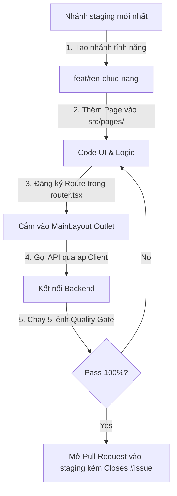

# 📖 HƯỚNG DẪN FRONTEND BASELINE DÀNH CHO 8 NHÓM ĐỒ ÁN (ISSUE #9)

> **Dự án:** Quản lý Văn bản và Tài liệu Bảo Long (QLVB & TLBM)  
> **Nhóm xây dựng Baseline:** Nhóm 1 (Kiến trúc App Shell, Xác thực & Dashboard)  
> **Áp dụng cho:** Toàn bộ các nhóm 1, 2, 3, 4, 5, 6, 7, 8  

---

## 🎯 1. Mục tiêu của bản Frontend Baseline

Bản Frontend Baseline là **mốc tham chiếu chuẩn mực** được đưa lên nhánh `staging`. Các nhóm khác khi nhận nhiệm vụ sẽ Fork hoặc tạo branch từ `staging` để bắt đầu phát triển module của nhóm mình mà không cần phải tự cấu hình lại giao diện, layout, định tuyến hay cơ chế gọi API.

---

## 🏗️ 2. Quyết định kỹ thuật bắt buộc (Technical Decisions)

1. **Cấu trúc phẳng, không dùng `modules/`:**  
   Toàn bộ mã nguồn tổ chức theo các thư mục chức năng rõ ràng:
   - `src/pages/`: Chứa các màn hình nghiệp vụ.
   - `src/components/common/`: Chứa các component dùng chung (`Button`, `Card`, `Table`, `Badge`, `Logo`).
   - `src/components/layout/`: Chứa `AppHeader`, `AppSidebar`, `AppFooter`, `UserDropdown`.
   - `src/lib/`: Chứa `apiClient.ts`, `authService.ts`, `constants.ts`, `routes.ts`.
   - `src/types/`: Khai báo kiểu dữ liệu TypeScript.
   - `src/i18n/`: Quản lý song ngữ (`vi.json`, `en.json`).
   - `src/styles/`: Design tokens và biến CSS tập trung.

2. **Khung sườn App Shell dùng chung (`MainLayout` & `<Outlet />`):**  
   Mọi route nghiệp vụ mới **bắt buộc phải nằm bên trong `<MainLayout />`** trong file `src/app/router.tsx`. Khi chuyển trang, Header, Sidebar và Footer sẽ luôn cố định, chỉ có khu vực nội dung bên trong `<Outlet />` thay đổi.

3. **Cơ chế gọi API & Xác thực tập trung (`apiClient`):**  
   - Tất cả request gọi Backend phải dùng `apiClient` (`import apiClient from '@lib/apiClient'`).
   - `apiClient` tự động quản lý Bearer Token, tự động gọi API Refresh Token khi gặp lỗi HTTP 401, và xử lý lỗi tập trung.
   - **Zero Mock Data:** Không lưu trữ dữ liệu giả lập (mock data) trong bundle sản phẩm. Nếu backend chưa trả về dữ liệu, hiển thị giao diện rỗng (Empty State) sạch sẽ.

4. **Phân quyền & Vai trò (Role/Permission):**  
   - Nhóm 1 không tự đặt ra cơ chế role/permission riêng lẻ.
   - Hợp đồng phân quyền (Contract) sẽ do **Nhóm 7 (Quản trị hệ thống)** cung cấp. Các nhóm tích hợp theo đúng contract này.
   - Nguồn kiểm tra quyền chính xác nhất (Source of Truth) luôn nằm ở Backend.

---

## 🚀 3. Quy trình phát triển tính năng cho nhóm tiếp theo



### Chi tiết các bước thực hiện:

1. **Tạo nhánh:** `git checkout staging && git pull origin staging && git checkout -b feat/<ten-tinh-nang>`
2. **Tạo trang:** Đặt file trong `src/pages/<nhom_module>/<TenTrang>Page.tsx`.
3. **Đăng ký Route:** Mở `src/app/router.tsx`, thêm `<Route path="..." element={<TenTrangPage />} />` bên trong `<Route element={<MainLayout />}>`.
4. **Kết nối API:** Sử dụng `apiClient.get()`, `apiClient.post()`.
5. **Kiểm thử Quality Gate:** Chạy đủ 5 lệnh bắt buộc:
   ```bash
   pnpm test
   pnpm lint
   pnpm build
   python backend/manage.py test
   python backend/manage.py check
   ```
6. **Tạo PR:** Mở Pull Request trỏ đích về `staging`, điền form đầy đủ và ghi rõ `Closes #<mã_issue>`.

---

## ✅ 4. Checklist nghiệm thu Baseline (Quality Gate Verification)

- [x] Cấu trúc Frontend chuẩn mực không dùng `modules/`.
- [x] Đăng ký Route hoạt động 100% trong `MainLayout` thông qua `<Outlet />`.
- [x] Đầy đủ các component dùng chung chuẩn mực (`Card`, `Button`, `Table`, `Badge`, `Logo`).
- [x] Xác thực thật bằng Django Authentication + SimpleJWT (`authService` & `apiClient`).
- [x] Xóa 100% dữ liệu giả lập (Zero Mock Data), xử lý Empty State tự nhiên.
- [x] Hỗ trợ song ngữ Tiếng Việt và Tiếng Anh hoàn chỉnh.
- [x] Đạt 100% Quality Gate: 40/40 Unit Tests PASS, 0 lỗi ESLint, build thành công không lỗi.
