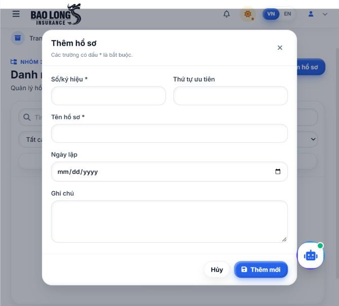
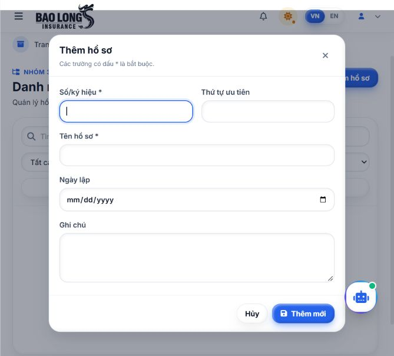
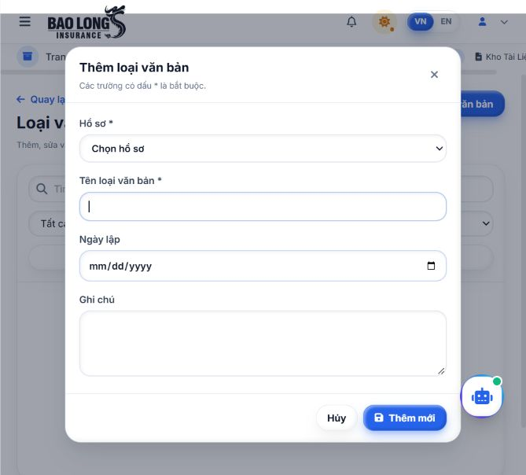

# Kiểm chứng focus của RecordModal trong StrictMode

Refs #149 — bổ sung cho PR #150, base `3_dossiers_documents`.

## Lỗi đã tái hiện

Kiểm tra ngày 15/10/2026 trên ứng dụng Vite development tại loopback local, backend Django và PostgreSQL 16 trong Docker local. `frontend/src/main.tsx` giữ nguyên `<StrictMode>` bao quanh ứng dụng.

Trước bản sửa, khi mở modal Thêm hồ sơ bằng nút trên trang danh mục, `document.activeElement` là nút mở phía sau modal. Nhấn Tab chuyển focus sang ô tìm kiếm của trang nền. Kết quả đọc DOM thực tế: `dialogOpen=true`, `focusInside=false`; sau Tab vẫn `focusInside=false`.

Test hồi quy cũng tái hiện trên mã trước sửa: 16 thất bại, 7 đạt trong 23 test `RecordModal`. Cả Thêm/Sửa Hồ sơ và Thêm/Sửa Loại văn bản đều trả focus ra nút mở sau effect replay.

Nguyên nhân tại effect cleanup cũ ở `RecordModal.tsx` dòng 85–87: cleanup khôi phục focus nhưng setup không thiết lập lại focus trong modal. StrictMode chạy setup → cleanup → setup khi mount trong development. `autoFocus` trên input không xử lý lại bước setup cuối này.

## Thay đổi

- Dùng ref cho ô Số/ký hiệu của Hồ sơ hoặc ô Tên loại văn bản.
- Effect setup đưa focus vào ô tương ứng; cleanup vẫn trả focus về phần tử mở còn trong DOM.
- Bỏ `autoFocus` trên hai ô này để tập trung việc thiết lập/khôi phục focus trong cùng lifecycle.
- Không phụ thuộc callback đóng hoặc trạng thái lưu trong effect focus, nên parent rerender với lỗi lưu không giành lại focus hay xóa dữ liệu.

## Các bước kiểm tra UI

1. Chạy backend local và Vite development; giữ StrictMode ở entry point. Đăng nhập bằng tài khoản local có quyền Records.
2. Vào Danh mục hồ sơ, mở Thêm. Kiểm tra caret/focus ở Số/ký hiệu.
3. Đi vòng bằng Tab và Shift+Tab, gồm các phần của input ngày. Focus phải luôn thuộc modal; tại biên phải quay vòng giữa nút cuối và nút Đóng.
4. Thử riêng Hủy, nút Đóng và Escape. Mỗi lần đóng phải trả focus về nút mở. Mở lại phải đặt focus vào trường đầu vào ban đầu.
5. Thực hiện tương tự với Sửa hồ sơ, Thêm/Sửa loại văn bản trên danh mục độc lập và danh mục theo hồ sơ. Với Loại văn bản, trường nhận focus là Tên loại văn bản.
6. Thử mở bằng Enter; kiểm tra danh sách hồ sơ cha tải xong không đẩy focus ra ngoài. Kiểm tra lỗi trường bắt buộc và lưu sửa thông qua API local.

| Trường hợp UI đã kiểm tra | Focus khi mở | Tab / Shift+Tab | Focus khi đóng |
|---|---|---|---|
| Thêm Hồ sơ | Số/ký hiệu | 14 Tab + 14 Shift+Tab, luôn trong modal | Hủy / Đóng / Escape về nút Thêm |
| Sửa Hồ sơ | Số/ký hiệu | 14 Tab + 14 Shift+Tab, luôn trong modal | Hủy / Đóng / Escape về nút Sửa |
| Thêm Loại văn bản, danh mục độc lập | Tên loại văn bản; mở bằng Enter | 14 Tab + 14 Shift+Tab, luôn trong modal | Hủy / Đóng / Escape về nút Thêm |
| Sửa Loại văn bản, danh mục độc lập | Tên loại văn bản | 14 Tab + 14 Shift+Tab, luôn trong modal | Hủy / Đóng / Escape về nút Sửa |
| Thêm Loại văn bản, trong hồ sơ | Tên loại văn bản | 14 Tab + 14 Shift+Tab, luôn trong modal | Hủy về nút Thêm |
| Sửa Loại văn bản, trong hồ sơ | Tên loại văn bản | 14 Tab + 14 Shift+Tab, luôn trong modal | Escape về nút Sửa |

168 lần di chuyển bàn phím ở sáu trường hợp trên đều giữ focus trong modal. Không mô phỏng thứ tự Tab bằng jsdom cho các phép thử UI này; dùng phím trong trình duyệt và đọc `document.activeElement` để đối chiếu. Hai biên vòng Tab có thêm assertion riêng trong test component.

UI local cũng đã kiểm tra: tạo Hồ sơ, tạo Loại văn bản với hồ sơ cha, chặn thiếu hồ sơ/tên toàn khoảng trắng, lưu sửa ghi chú và tải lại danh sách. Không kết luận kiểm tra đầy đủ mọi nghiệp vụ CRUD từ các phép thử focus này.







Kết quả đo được chuẩn hóa trong [ui-focus-summary.json](evidence/pr150-focus/ui-focus-summary.json), không chứa tài khoản, token hoặc ID dữ liệu kiểm thử.

## Test và kiểm tra local

`RecordModal.test.tsx` bổ sung 20 test tham số hóa trong `React.StrictMode`: bốn tổ hợp loại form và Thêm/Sửa, mỗi tổ hợp kiểm tra focus khi mở, hai biên Tab, ba cách đóng và mở lại, cùng việc giữ focus/dữ liệu sau parent rerender với lỗi lưu. Component có tổng 23 test sau bổ sung.

Lệnh chạy từ thư mục gốc:

```powershell
pnpm --dir frontend exec vitest run --config vite.config.ts src/components/records/RecordModal.test.tsx
pnpm --dir frontend exec vitest run --config vite.config.ts --maxWorkers=2
pnpm --dir frontend run lint
pnpm --dir frontend run build
pnpm --dir frontend run check:i18n
pnpm --dir frontend run check:tokens
pnpm --dir frontend run check:records:i18n
pnpm --dir frontend run check:records:tokens
```

| Kiểm tra | Kết quả lần chạy này |
|---|---|
| RecordModal | 23/23 test đạt |
| Toàn bộ frontend | 39 file, 269/269 test đạt; bao gồm DossiersPage và DocumentTypesPage |
| ESLint toàn bộ frontend | Đạt, không có lỗi/cảnh báo ESLint |
| TypeScript và Vite build | Đạt; còn cảnh báo bundle chung lớn và thông báo thời gian plugin |
| i18n toàn bộ và Records | Đạt, 1196 key đồng bộ |
| CSS tokens toàn bộ và Records | Đạt |
| Django `manage.py check`, `config.settings`, DB local | Đạt, 0 issue |
| `git diff --check` | Đạt trước commit |

## Cảnh báo và giới hạn

- Build còn cảnh báo chunk minify lớn hơn 500 kB; bundle chính khoảng 1001 kB. Không thay đổi cấu hình chia bundle hoặc CI trong bản sửa focus.
- Test ký số in cảnh báo PDF.js: `Please use the legacy build in Node.js environments.` Bộ test vẫn đạt; chưa sửa module ký số trong nhiệm vụ này.
- Vitest in gợi ý về chi phí tạo jsdom. Lần chạy đầu trong sandbox lỗi đọc cache tạm trước khi thực thi test; không tính lần đó là đạt. Lần chạy lại ngoài sandbox với tối đa hai worker thực thi đủ 269 test và đạt.
- UI kiểm tra trên trình duyệt Chromium local bằng bàn phím; chưa kiểm tra screen reader, trình duyệt khác hoặc toàn bộ nghiệp vụ các nhóm khác.
- Các test frontend dùng mock API; UI nêu trên dùng Auth và Records thật trên PostgreSQL local. Các lỗi 403/409, chống submit trùng và xóa được bao phủ bởi test frontend hiện có; không đánh dấu đã chạy lại toàn bộ các trường hợp đó trên UI ở lần kiểm tra focus này.
- Kết quả local không thay thế CI trên GitHub hoặc phê duyệt của nhóm trưởng. Trạng thái CI được cập nhật riêng trên PR theo commit cuối.
