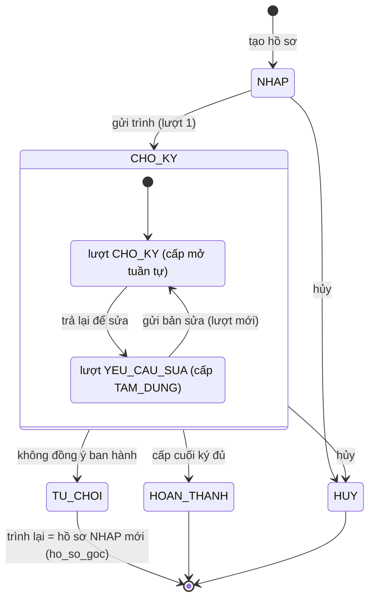

# Module 05: Trình ký số (Nhóm 5)

Phân hệ trình ký văn bản đi qua nhiều cấp, ký điện tử nội bộ Ed25519, kết thúc ở **hoàn tất duyệt nội bộ, chưa phát
hành**. Giao diện ở `/approvals`, API dưới `/api/v1/signing/`.

Tài liệu liên quan (không chép lại ở đây):

- [`signing-backend-plan.md`](signing-backend-plan.md): quy tắc nghiệp vụ, bất biến, thiết kế dữ liệu, máy trạng thái, API.
- [`danh-gia-plan-va-tich-hop.md`](danh-gia-plan-va-tich-hop.md): đánh giá plan và tích hợp với các nhóm.
- [`du-lieu-mau-va-tinh-trang-nghiep-vu.md`](du-lieu-mau-va-tinh-trang-nghiep-vu.md): bảng tình trạng flow, file khóa,
  ủy quyền, dữ liệu mẫu chi tiết, hợp đồng API Dashboard đầy đủ.
- [`spec.md`](spec.md), [`qa-test-cases-80.md`](qa-test-cases-80.md).

## 1. Flow nghiệp vụ

| Flow | Tình trạng |
|---|---|
| Quy trình mẫu: tạo nháp, sửa, kích hoạt, ngừng, nhân bản phiên bản; phạm vi công ty/phòng ban | Xong |
| Tạo hồ sơ nháp (văn bản đi, quy trình, PDF, hạn chót), sửa nháp | Xong |
| Trình ký: khóa tệp và mã băm, chọn người ký theo chức vụ, đặt vị trí ký | Xong |
| Ký tuần tự theo cấp, song song trong cấp, ký nháy chặn ký chính | Xong |
| Khóa ký Ed25519 + PIN 8 số (Argon2id + salt, `k_srv`); xuất file khóa; ký bằng file khóa + PIN | Xong |
| Không đồng ý ban hành (kết thúc); trình lại thành hồ sơ mới | Xong |
| Trả lại để sửa → trao đổi → gửi bản sửa → lượt trình mới | Xong |
| Hủy (người tạo; quản trị hủy thay có lý do); thu hồi chữ ký khi cấp còn mở | Xong |
| Hoàn tất: bằng chứng tổng hợp, PDF hoàn tất, xác minh lại | Xong |
| Ủy quyền ký khẩn cấp từng hồ sơ | Xong |
| Thông báo trong ứng dụng + email (gửi lại khi lỗi), nhắc hạn/quá hạn | Xong |
| Ủy quyền theo thời gian, thể thức KT./TL./TUQ., leo thang quá hạn | Chưa làm (mục 8) |

Trạng thái hồ sơ (`signing_request.trang_thai`) và lượt trình (`signing_attempt.trang_thai`):



Khi hồ sơ từ chối hoặc hủy, cấp đang ký chuyển `TAM_DUNG`; người chưa ký hiển thị "Không còn cần ký".

## 2. Vai trò và quyền

Quyền kiểm ở API/service (`backend/apps/signing/permissions.py`), giao diện chỉ ẩn/hiện. Nhóm quyền chuẩn lấy từ
DDL/RBAC (Nhóm 7):

| Nhóm | Trình ký |
|---|---|
| Văn thư (VT) | xem, tạo, gửi trình ký |
| Chuyên viên (CV) | xem, tạo nháp (không có `send_trinhky`) |
| Trưởng phòng (TP) | xem, tạo, gửi, ký, ủy quyền (người ký cùng đơn vị), hủy thay, quản lý quy trình phòng ban |
| Ban Giám đốc (BGD) | xem, tạo, gửi, ký, ủy quyền, hủy thay, xem nhật ký mọi hồ sơ |
| Quản trị (ADMIN) | toàn quyền, quản lý quy trình công ty |

Codename: `view_trinhky`, `add_trinhky`, `send_trinhky`, `sign_trinhky`, `delegate_trinhky`, `cancel_trinhky`,
`manage_signing_process`, `view_signing_audit`.

## 3. Cấu trúc thư mục chính

```text
backend/apps/signing/
  models.py, enums.py, permissions.py, errors.py   # model theo DDL, mã trạng thái, kiểm quyền, định dạng lỗi
  services/                                        # nghiệp vụ: trinh_ky, hanh_dong_ky, yeu_cau_sua, uy_quyen,
                                                   #   keys, pin, thong_bao, bang_chung, tep_hoan_tat, process
  selectors.py                                     # selector chỉ đọc cho module khác (Dashboard)
  tich_hop/                                        # đọc văn bản đi (Nhóm 2), tổ chức/nhân sự (Nhóm 7)
  views.py, urls.py, serializers.py                # API /api/v1/signing/
  management/commands/                             # seed_signing_demo, nhac_han_trinh_ky, gui_thong_bao_trinh_ky
  tests/
frontend/src/
  pages/signing/          # SigningModule (route /approvals/*), DanhSach, TaoHoSo, ChiTiet, QuyTrinh, Khoa, ThongBao, TaiLieu
  components/signing/     # HanhDong, TienTrinh, XemPdf, TraoDoiPanel, KetQuaPanel, ...
  lib/signing/            # api, types, khoaKy (Ed25519, Argon2id, AES-GCM), fileKhoa, luongKhoa, pdf, i18n vi/en
```

## 4. API chính (`/api/v1/signing/`)

| Đường dẫn | Mục đích |
|---|---|
| `quy-trinh/`, `quy-trinh/{id}/`, `quy-trinh/{id}/{kich-hoat,ngung,nhan-ban}/` | Quy trình mẫu |
| `trinh-ky/` (GET `?hop=can_toi_ky\|toi_gui\|tat_ca`, POST multipart) | Danh sách, tạo nháp |
| `trinh-ky/{id}/` (GET, PATCH) | Chi tiết (lượt, cấp, người ký, `lich_su`), sửa nháp |
| `trinh-ky/{id}/{gui,huy,trinh-lai}/` | Gửi, hủy, trình lại |
| `trinh-ky/{id}/{ky,tu-choi,thu-hoi,yeu-cau-sua,uy-quyen}/` | Hành động người ký, ủy quyền khẩn cấp |
| `trinh-ky/{id}/{trao-doi,giai-quyet}/` | Trao đổi khi trả sửa, gửi bản sửa |
| `trinh-ky/{id}/{tep,tep-hoan-tat,bang-chung,tao-lai-tep-hoan-tat}/` | Tệp, tệp hoàn tất, bằng chứng |
| `khoa/`, `khoa/{id}/{thach-thuc,xac-minh,kich-hoat,thu-hoi,xoay-vong,dat-pin,mo-khoa-ky,doi-pin}/` | Khóa ký, PIN |
| `thong-bao/`, `tai-lieu/`, `toi/`, `nguoi-dung/`, `don-vi/`, `van-ban-di/` | Hỗ trợ giao diện |
| `dashboard/` | Dữ liệu Dashboard/Header cho Nhóm 1 |

Thao tác đổi trạng thái bắt buộc header `Idempotency-Key`. Lỗi trả dạng `{"code", "detail", "fields"}` (tiếng Việt).

### `GET /api/v1/signing/dashboard/` (Nhóm 1)

Yêu cầu đăng nhập (JWT); chưa đăng nhập trả 401. Chỉ dữ liệu của người đang đăng nhập. Backend có thể gọi
`signing.selectors.tong_quan_dashboard(user)`. Mẫu (rút gọn từ dữ liệu `seed_signing_demo`, tài khoản `truongphong`;
bản đầy đủ ở `du-lieu-mau-va-tinh-trang-nghiep-vu.md` mục 6.2):

```json
{
  "so_cho_ky": 2,
  "gan_day": [
    {
      "id": 2,
      "tieu_de": "102/TTr-CNTT — Tờ trình mua sắm thiết bị mạng cho văn phòng khu vực",
      "nguoi_trinh": "Văn thư Ban CNTT",
      "ngay_trinh": "2026-10-21T15:29:41.935258+07:00",
      "trang_thai": "CHO_KY",
      "nhan_trang_thai": "Chờ ký",
      "can_toi_ky": true
    }
  ]
}
```

`gan_day` tối đa 5 phiếu, mới nhất trước. `trang_thai`: `NHAP`, `CHO_KY`, `HOAN_THANH`, `TU_CHOI`, `HUY`
(nhãn: Nháp, Chờ ký, Đã ký, Từ chối, Đã hủy).

## 5. Cấu hình môi trường (`backend/.env`, không commit giá trị bí mật)

| Biến | Ghi chú |
|---|---|
| `SIGNING_DOCUMENT_ROOT` | Thư mục lưu tệp PDF, ảnh chữ ký snapshot, tệp hoàn tất |
| `SIGNING_PIN_SECRET` | Bí mật máy chủ cho PIN và `k_srv`; bắt buộc trên staging/production (`check --deploy` báo `signing.E001/E002`) |
| `SIGNING_PDF_FONT`, `SIGNING_PDF_FONT_BOLD` | Phông có dấu cho PDF hoàn tất; trống thì tự dò phông hệ thống |
| `SIGNING_EMAIL_BACKEND` | Trống: dùng cấu hình email chung; dev có thể đặt console backend |
| `SIGNING_FRONTEND_URL` | Địa chỉ giao diện dùng trong liên kết email |
| `EMAIL_HOST`, `EMAIL_PORT`, `EMAIL_USE_TLS`, `EMAIL_HOST_USER`, `EMAIL_HOST_PASSWORD`, `DEFAULT_FROM_EMAIL` | SMTP chung của dự án; `EMAIL_HOST` trống thì email in ra console |
| `DEMO_PASSWORD` | Mật khẩu tài khoản mẫu của `seed_signing_demo` |

## 6. Cách chạy

```bash
pnpm db:setup                                           # dựng DB local (scripts/build_db.py --seed)
cd backend
DEMO_PASSWORD='<mật khẩu demo>' python manage.py seed_signing_demo   # dữ liệu mẫu, chạy lại không nhân bản
python manage.py seed_signing_demo --reset              # hủy bộ hồ sơ mẫu cũ (bằng chứng giữ nguyên) rồi tạo lại
python manage.py nhac_han_trinh_ky                      # nhắc hạn/quá hạn, chạy định kỳ
python manage.py gui_thong_bao_trinh_ky                 # gửi lại email lỗi, chạy định kỳ
python manage.py runserver                              # cùng `pnpm dev` ở frontend
```

Trên staging, deploy chỉ chạy migration; lệnh dữ liệu mẫu chạy tay một lần trên máy chủ (xem
`du-lieu-mau-va-tinh-trang-nghiep-vu.md` mục 5.4).

Tài khoản mẫu: `truongphong` (ký cấp 1, có hồ sơ chờ ký), `giamdoc` (ký cấp 2, ký thay theo ủy quyền), `vanthu`
(người trình, đủ trạng thái), `chuyenvien` (soạn nháp), `admin` (quản trị, ủy quyền). Sau khi chạy lệnh mẫu, mỗi người
ký tự tạo khóa ký ở trang **Khóa ký & PIN** (tải file khóa) trước khi ký.

## 7. Kiểm thử

```bash
python backend/manage.py test signing                   # PostgreSQL 16
python backend/manage.py test                           # toàn bộ
pnpm --dir frontend lint && pnpm --dir frontend exec tsc -b
pnpm --dir frontend check:i18n && pnpm --dir frontend check:tokens
pnpm --dir frontend test && pnpm --dir frontend build
```

Kết quả tại PR #251 (local, PostgreSQL 16): backend toàn bộ 1069 test, 0 skip, đạt; `test signing` 265 test đạt;
frontend lint, typecheck, i18n, tokens sạch, 525 test đạt, build đạt. E2E Playwright Chromium trên dữ liệu mẫu: tạo
khóa và tải file khóa, ký bằng file khóa + PIN, trả sửa, gửi bản sửa, không đồng ý ban hành, hủy, ủy quyền, xem PDF
desktop và mobile 390px, thông báo có người thực hiện và lý do.

## 8. Chưa làm và lý do

- Ủy quyền theo thời gian (`signing_delegation`) và thể thức `hinh_thuc_ky` (KT./TL./TUQ.): DDL chưa có bảng/cột, cần
  PR đổi schema riêng (DDL + migration + `DDL_CHANGELOG.md`).
- Leo thang quá hạn cho cấp trên trực tiếp: chưa có dữ liệu cấp trên trực tiếp từ Nhóm 7.
- Nhóm Chuyên viên chưa có `send_trinhky` nên chỉ tạo nháp, văn thư hoặc người có quyền gửi trình. Cấp thêm quyền phải
  sửa RBAC seed của Nhóm 7 và DDL ở PR riêng (AGENTS.md mục 6).
- Đánh dấu đã đọc thông báo lưu ở trình duyệt; bảng `signing_notification` chưa có cột đã đọc.

## 9. Nhật ký thay đổi PR #251

- Ủy quyền ký khẩn cấp `POST trinh-ky/{id}/uy-quyen/`; người giao ủy quyền vẫn xem được hồ sơ; giao diện "Ký thay".
- File khóa `.tlbmkey` (bản bọc private key): xuất khi tạo khóa và đổi PIN, nhập vào thiết bị, ký bằng file + PIN.
- Thông báo: hủy báo người tạo (khi hủy thay) và người đã ký; tin nhắn trao đổi; nhắc hạn/quá hạn (`nhac_han_trinh_ky`);
  số thông báo mới ở tab; email và thông báo ghi người thực hiện và lý do.
- Lịch sử hiển thị người thực hiện; ghi "Gửi trình ký" trước "Mở cấp ký".
- API Dashboard cho Nhóm 1 và selector `tong_quan_dashboard`.
- Lệnh dữ liệu mẫu duy nhất `seed_signing_demo` (`--reset`, mật khẩu từ `DEMO_PASSWORD`); gỡ lệnh cũ
  `seed_demo_signing` (ghi cứng mật khẩu, khóa bí mật suy ra từ chuỗi cố định).
- Lỗi từ rà soát E2E staging:
  - vùng xem PDF trắng do pdfjs-dist 5.x gọi `Map.prototype.getOrInsertComputed`: dùng bản legacy có polyfill, hiện lỗi
    thay vì nuốt, hủy lần vẽ cũ trước khi vẽ lại;
  - danh sách trên màn hình 390px mất cột trạng thái: dạng thẻ cho màn hình hẹp;
  - hồ sơ từ chối/hủy vẫn "đang ký": cấp chuyển `TAM_DUNG`, người chưa ký "Không còn cần ký";
  - email từ chối, trả sửa, hủy thiếu lý do và người thao tác: đã bổ sung;
  - lỗi 404/401 của API trả tiếng Anh: trả tiếng Việt;
  - hồ sơ trả lại hiện "Đang chờ ký", quá hạn không có dấu: badge "Đang trả lại để sửa", "Quá hạn";
  - tab tài liệu "Văn bản công khai": đổi thành "Tệp trình ký";
  - nút trợ lý AI nổi che nút hành động: chừa khoảng dưới trong trang Trình ký;
  - bổ sung test frontend cho TaoHoSoPage, KhoaPage, TraoDoiPanel, KetQuaPanel, XemPdf.
