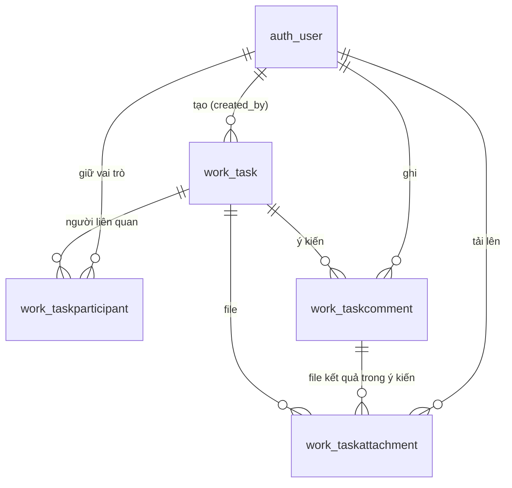

# Module 06 — Cơ sở dữ liệu (Công việc)

- App Django: `backend/apps/work/` (tên app `work`, bảng có tiền tố `work_`)
- Migration: `0001_initial`, `0002_taskattachment_comment_and_more`
- Khóa chính mọi bảng: `BigAutoField`
- Người dùng: tạm dùng `auth_user` của Django. Khi nhóm 7 có model Cán bộ nhân viên thì đổi các khóa ngoại tới người dùng sang model đó.

## 1. Sơ đồ quan hệ

## 2. Bảng

### 2.1. `work_task` — Công việc

| Cột | Kiểu | Bắt buộc | Mô tả |
|---|---|---|---|
| `id` | bigint | ✔ | Khóa chính |
| `title` | text | ✔ | Nội dung công việc |
| `created_date` | date | ✔ | Ngày tạo (ngày thuần, không giờ). Mặc định hôm nay theo giờ Việt Nam |
| `due_date` | date | ✔ | Ngày xử lý / hạn xử lý (ngày thuần) |
| `requirement` | text | ✔ | Yêu cầu xử lý |
| `created_by_id` | FK → `auth_user` | ✔ | Người tạo và giao việc. `PROTECT`: không xóa được người đã giao việc |
| `is_public` | bool | ✔ | Trạng thái hiển thị. `false` = đang ẩn, chỉ người tạo và quản trị viên thấy. Mặc định `true` |
| `first_opened_at` | datetime | | Thời điểm chủ trì / chỉ đạo / tham gia mở công việc lần đầu (trước hạn) |
| `first_opened_by_id` | FK → `auth_user` | | Người mở lần đầu. `SET_NULL` |
| `approved_at` | datetime | | Thời điểm duyệt hoàn thành. `NULL` = chưa duyệt hoặc đã hủy duyệt |
| `approved_by_id` | FK → `auth_user` | | Người duyệt. `SET_NULL` |
| `created_at` | datetime | ✔ | Thời điểm hệ thống ghi bản ghi |
| `updated_at` | datetime | ✔ | Thời điểm sửa gần nhất |

- Ràng buộc `work_task_due_after_created`: `due_date >= created_date`.
- Chỉ mục: `created_date` (lọc theo khoảng ngày tạo), `due_date` (tính quá hạn).
- **Không có cột trạng thái.** Trạng thái được tính khi truy vấn, xem mục 3.
- Dự kiến thêm: khóa ngoại `van_ban` (cho phép trống) tới Văn bản đến / đi của nhóm 2, chờ nhóm 2 chốt tên model (đã để `TODO` trong `models.py`).

### 2.2. `work_taskparticipant` — Người liên quan

| Cột | Kiểu | Bắt buộc | Mô tả |
|---|---|---|---|
| `id` | bigint | ✔ | Khóa chính |
| `task_id` | FK → `work_task` | ✔ | `CASCADE`: xóa công việc thì xóa theo |
| `user_id` | FK → `auth_user` | ✔ | Cán bộ. `PROTECT` |
| `role` | varchar(20) | ✔ | `CHU_TRI` (chủ trì giải quyết), `CHI_DAO` (chỉ đạo - theo dõi tiến độ), `THAM_GIA` (cán bộ tham gia) |

- `work_participant_one_role_per_user`: duy nhất (`task_id`, `user_id`) — mỗi cán bộ chỉ giữ một vai trò trong một công việc.
- `work_participant_one_host`: duy nhất `task_id` khi `role = 'CHU_TRI'` — mỗi công việc đúng một người chủ trì.
- Chỉ mục (`user_id`, `role`): tìm nhanh công việc của một cán bộ.
- Người tạo **không** lưu ở bảng này (lấy từ `work_task.created_by_id`) nhưng được phép kiêm một vai trò, kể cả chủ trì.

### 2.3. `work_taskcomment` — Ý kiến xử lý

| Cột | Kiểu | Bắt buộc | Mô tả |
|---|---|---|---|
| `id` | bigint | ✔ | Khóa chính |
| `task_id` | FK → `work_task` | ✔ | `CASCADE` |
| `author_id` | FK → `auth_user` | ✔ | Người ghi. `PROTECT` |
| `content` | text | ✔ | Nội dung; được để trống khi ý kiến có kèm file kết quả |
| `created_at` | datetime | ✔ | Thời điểm gửi (đủ giờ - phút - giây) |

- Chỉ mục (`task_id`, `created_at`): đọc ý kiến theo thứ tự cũ → mới.
- Ý kiến đã ghi **không sửa, không xóa** (không có API sửa / xóa).

### 2.4. `work_taskattachment` — File đính kèm

| Cột | Kiểu | Bắt buộc | Mô tả |
|---|---|---|---|
| `id` | bigint | ✔ | Khóa chính |
| `task_id` | FK → `work_task` | ✔ | `CASCADE` |
| `kind` | varchar(20) | ✔ | `GIAO_VIEC` (đính kèm lúc giao việc) hoặc `BANG_CHUNG` (file kết quả) |
| `comment_id` | FK → `work_taskcomment` | | Ý kiến chứa file. `CASCADE` |
| `file` | varchar(255) | ✔ | Đường dẫn trong `media/`: `06_tasks/<năm>/<tháng>/<chuỗi ngẫu nhiên>.<đuôi>` |
| `original_name` | varchar(255) | | Tên file gốc người dùng tải lên (dùng khi tải về) |
| `size` | bigint | ✔ | Dung lượng (byte) |
| `uploaded_by_id` | FK → `auth_user` | ✔ | Người tải lên. `PROTECT` |
| `uploaded_at` | datetime | ✔ | Thời điểm tải lên |

- `work_attachment_evidence_in_comment`: `(kind = 'GIAO_VIEC' AND comment_id IS NULL) OR (kind = 'BANG_CHUNG' AND comment_id IS NOT NULL)` — file kết quả luôn nằm trong một ý kiến, file giao việc thì không.
- Chỉ mục (`task_id`, `kind`): tính nhanh "có file kết quả hay chưa".
- Định dạng cho phép: PDF, DOC, DOCX, JPG, JPEG, PNG; mỗi file **dưới 20 MB**; ảnh được kiểm tra nội dung thật (đổi đuôi `.exe` thành `.png` sẽ bị chặn).
- Xóa bản ghi thì file vật lý được xóa sau khi transaction thành công.
- File chỉ tải được qua API có kiểm tra quyền xem công việc; thư mục `media/` không mở công khai.

## 3. Trạng thái công việc (tính khi truy vấn)

Trạng thái được tính ngay trong câu SQL (`TaskQuerySet.with_status()`), nên lọc theo trạng thái và phân trang luôn đúng, không cần tác vụ chạy định kỳ. Xét theo thứ tự, gặp điều kiện đúng đầu tiên thì dừng:

| # | Trạng thái | Mã | Điều kiện |
|---|---|---|---|
| 1 | Hoàn thành | `HOAN_THANH` | `approved_at` có giá trị |
| 2 | Chờ duyệt | `CHO_DUYET` | Còn ít nhất 1 file `BANG_CHUNG` (kể cả khi đã quá hạn) |
| 3 | Chưa hoàn thành | `CHUA_HOAN_THANH` | `due_date` < hôm nay và đã từng được mở |
| 4 | Quá hạn | `QUA_HAN` | `due_date` < hôm nay và chưa ai mở |
| 5 | Đang xử lý | `DANG_XU_LY` | Đã được mở |
| 6 | Chờ xử lý | `CHO_XU_LY` | Còn lại |

- "Hôm nay" tính theo giờ Việt Nam (`TIME_ZONE = "Asia/Ho_Chi_Minh"`). Hạn là hôm nay thì chưa tính quá hạn.
- Chưa hoàn thành và Quá hạn là trạng thái **bị khóa**: không sửa, không ghi ý kiến, không nộp kết quả, không duyệt.
- Xóa hết file kết quả thì công việc quay về Đang xử lý; hủy duyệt thì quay về Chờ duyệt.

## 4. Quy tắc quyền (hàm `check_*` / `can_*` trong `models.py`)

| Thao tác | Ai được làm | Điều kiện trạng thái |
|---|---|---|
| Xem | Người tạo, chủ trì, chỉ đạo, tham gia, quản trị viên | Công việc đang ẩn: chỉ người tạo và quản trị viên |
| Sửa | Người tạo, chủ trì | Chờ xử lý, Đang xử lý |
| Xóa (xóa hẳn) | Người tạo, chủ trì | Mọi trạng thái |
| Ghi nhận "đã mở" | Chủ trì, chỉ đạo, tham gia (người tạo mở không tính) | Chưa quá hạn |
| Ghi ý kiến | Mọi người liên quan | Không bị khóa |
| Kèm file kết quả vào ý kiến | Chủ trì, tham gia | Không bị khóa, chưa Hoàn thành |
| Xóa file kết quả | Chỉ người đã tải file đó | Chưa duyệt; sau hạn không xóa được file kết quả cuối cùng |
| Duyệt / hủy duyệt | Người tạo, chủ trì, chỉ đạo | Duyệt khi Chờ duyệt (kể cả đã quá hạn); hủy duyệt khi Hoàn thành |

Quản trị viên (`is_superuser`) chỉ được xem, trừ khi cũng là người liên quan của công việc.
