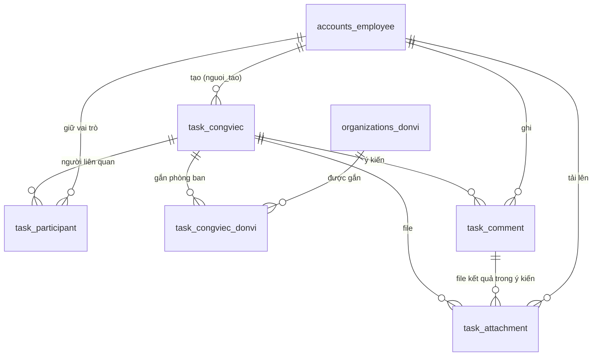

# Module 06 — Cơ sở dữ liệu (Công việc)

- App Django: `backend/apps/work/` (tên app `work`)
- **Tên bảng và tên cột theo đúng CSDL chính thức PM chốt** (`csdl_qlvbtl_schema_final.sql`). Tên field trong Python giữ tiếng Anh cho khớp API camelCase và code frontend, ánh xạ sang tên PM bằng `db_table` / `db_column`.
- Migration: `0001_initial`, `0002_taskattachment_comment_and_more`, `0003_taskdonvi_alter_task_options_and_more`
- CSDL dùng chung: PostgreSQL `quanlyvanban_db`. **Migration của module chưa chạy trên DB chung** — xem mục 6.
- Người dùng: các khóa ngoại trỏ vào `settings.AUTH_USER_MODEL`. Khi nhóm 7 khai báo `AUTH_USER_MODEL = 'accounts.Employee'` thì khóa ngoại tự trỏ sang `accounts_employee`, chỉ cần tạo thêm migration.

## 1. Sơ đồ quan hệ

## 2. Bảng

### 2.1. `task_congviec` — Công việc

| Cột (DB) | Field Python | Kiểu | Bắt buộc | Mô tả |
|---|---|---|---|---|
| `id` | `id` | bigint | ✔ | Khóa chính |
| `noi_dung` | `title` | text | ✔ | Nội dung công việc |
| `ngay_tao_cv` | `created_date` | date | ✔ | Ngày tạo (ngày thuần). Mặc định hôm nay theo giờ Việt Nam |
| `ngay_xu_ly` | `due_date` | date | ✔ | Hạn xử lý (ngày thuần) |
| `yeu_cau_xu_ly` | `requirement` | text | ✔ | Yêu cầu xử lý |
| `nguoi_tao` | `created_by` | FK người dùng | ✔ | Người tạo và giao việc (`PROTECT`) |
| `document_type` | `document_type` | varchar(20) | | Văn bản liên quan: `vanbanden`, `vanbandi`, `vanbanmat` |
| `document_id` | `document_id` | bigint | | Id văn bản của nhóm 2 |
| `hien_thi` | `is_public` | bool | ✔ | `false` = đang ẩn. Mặc định `true` |
| `opened_at` | `first_opened_at` | timestamptz | | Lần đầu người thực hiện mở công việc |
| `opened_by` | `first_opened_by` | FK người dùng | | Người mở lần đầu (`SET_NULL`) |
| `approved_at` | `approved_at` | timestamptz | | Thời điểm duyệt. `NULL` = chưa duyệt hoặc đã hủy duyệt |
| `approved_by` | `approved_by` | FK người dùng | | Người duyệt (`SET_NULL`) |
| `created_at` | `created_at` | timestamptz | ✔ | Hệ thống ghi |
| `updated_at` | `updated_at` | timestamptz | ✔ | Sửa gần nhất |

- `work_task_due_after_created`: `ngay_xu_ly >= ngay_tao_cv`.
- `chk_task_document`: hoặc trống cả `document_type` và `document_id`, hoặc có đủ cả hai.
- Chỉ mục: `ngay_tao_cv`, `ngay_xu_ly`.
- **Không có cột trạng thái** — trạng thái tính khi truy vấn, xem mục 3.
- Quyền khai báo trong `Meta.permissions`: `view_all_congviec`, `view_dept_congviec`, `approve_congviec`.
  ⚠️ `approve_congviec` **không** dùng làm điều kiện chặn duyệt; quyền duyệt xét theo vai trò (mục 4.2).

### 2.2. `task_participant` — Người liên quan

| Cột (DB) | Field Python | Kiểu | Mô tả |
|---|---|---|---|
| `id` | `id` | bigint | Khóa chính |
| `cong_viec` | `task` | FK `task_congviec` | `CASCADE` |
| `can_bo` | `user` | FK người dùng | `PROTECT` |
| `vai_tro` | `role` | varchar(20) | `CHU_TRI`, `CHI_DAO`, `THAM_GIA` |

- `uq_task_participant`: duy nhất (`cong_viec`, `can_bo`) — mỗi cán bộ giữ một vai trò trong một công việc.
- `work_participant_one_host`: duy nhất `cong_viec` khi `vai_tro = 'CHU_TRI'` — đúng một người chủ trì.
- Người tạo không lưu ở bảng này (lấy từ `nguoi_tao`) nhưng được phép kiêm một vai trò.

### 2.3. `task_congviec_donvi` — Phòng ban của công việc

| Cột (DB) | Field Python | Kiểu | Mô tả |
|---|---|---|---|
| `id` | `id` | bigint | Khóa chính |
| `cong_viec` | `task` | FK `task_congviec` | `CASCADE` |
| `don_vi` | `don_vi_id` | bigint | Id `organizations_donvi`. **Chưa phải khóa ngoại** vì app `organizations` chưa có trên nhánh `6_tasks` (`TODO` trong `models.py`) |
| `created_at` | `created_at` | timestamptz | Thời điểm gắn |

- `uq_task_congviec_donvi`: duy nhất (`cong_viec`, `don_vi`).
- Một công việc gắn được nhiều phòng/ban; dùng cho quyền xem theo phòng ban.

### 2.4. `task_comment` — Ý kiến xử lý

| Cột (DB) | Field Python | Kiểu | Mô tả |
|---|---|---|---|
| `id` | `id` | bigint | Khóa chính |
| `cong_viec` | `task` | FK `task_congviec` | `CASCADE` |
| `nguoi_ghi` | `author` | FK người dùng | `PROTECT` |
| `noi_dung` | `content` | text | Được để trống khi ý kiến có kèm file |
| `created_at` | `created_at` | timestamptz | Thời điểm gửi (đủ giờ - phút - giây) |

Ý kiến đã ghi **không sửa, không xóa** (không có API sửa / xóa).

### 2.5. `task_attachment` — File đính kèm (bản 9 cột)

| Cột (DB) | Field Python | Kiểu | Mô tả |
|---|---|---|---|
| `id` | `id` | bigint | Khóa chính |
| `name` | `original_name` | varchar(255) | Tên file gốc để hiển thị và tải về |
| `path` | `file` | varchar(500) | Đường dẫn trong `media/`: `06_tasks/<năm>/<tháng>/<chuỗi ngẫu nhiên>.<đuôi>` |
| `cong_viec_id` | `task` | FK `task_congviec` | `CASCADE` |
| `y_kien_id` | `comment` | FK `task_comment` | `CASCADE`. Trống với file giao việc |
| `loai` | `kind` | varchar(20) | `GIAO_VIEC` hoặc `BANG_CHUNG` |
| `is_deleted` | `is_deleted` | bool | **Xóa mềm**: gỡ file thì bật cờ này, không xóa bản ghi |
| `created_time` | `uploaded_at` | timestamptz | Thời điểm tải lên |
| `created_user_id` | `uploaded_by` | FK người dùng | Người tải lên (`PROTECT`) |

- `work_attachment_evidence_in_comment`: file `BANG_CHUNG` bắt buộc thuộc một ý kiến, file `GIAO_VIEC` thì không.
- **Không có cột dung lượng** (đúng 9 cột PM chốt). Dung lượng đọc từ kho lưu trữ qua property `size` của model.
- Định dạng cho phép: PDF, DOC, DOCX, JPG, JPEG, PNG; mỗi file dưới 20 MB; ảnh được kiểm tra nội dung thật.
- File `is_deleted = true` không hiện trong API, không tải xuống được, không tính vào trạng thái.
- Xóa công việc (xóa cứng) thì xóa luôn bản ghi và file vật lý.

## 3. Trạng thái công việc (tính khi truy vấn)

Tính ngay trong câu SQL (`TaskQuerySet.with_status()`) nên lọc theo trạng thái và phân trang luôn đúng. Xét theo thứ tự, gặp điều kiện đúng đầu tiên thì dừng:

| # | Trạng thái | Mã | Điều kiện |
|---|---|---|---|
| 1 | Hoàn thành | `HOAN_THANH` | `approved_at` có giá trị |
| 2 | Chờ duyệt | `CHO_DUYET` | Còn file `BANG_CHUNG` chưa xóa mềm (kể cả khi đã quá hạn) |
| 3 | Chưa hoàn thành | `CHUA_HOAN_THANH` | `ngay_xu_ly` < hôm nay và đã từng được mở |
| 4 | Quá hạn | `QUA_HAN` | `ngay_xu_ly` < hôm nay và chưa ai mở |
| 5 | Đang xử lý | `DANG_XU_LY` | `opened_at` có giá trị |
| 6 | Chờ xử lý | `CHO_XU_LY` | Còn lại |

- "Hôm nay" theo giờ Việt Nam (`TIME_ZONE = "Asia/Ho_Chi_Minh"`). Hạn là hôm nay thì chưa tính quá hạn.
- Chưa hoàn thành và Quá hạn là trạng thái **bị khóa**: không sửa, không ghi ý kiến, không nộp kết quả, không duyệt.
- Xóa hết file kết quả thì quay về Đang xử lý; hủy duyệt thì quay về Chờ duyệt.

## 4. Quyền

### 4.1. Quyền xem — 3 lớp

Người dùng thấy một công việc khi thỏa **một trong ba**:

1. **Người liên quan**: là người tạo, hoặc có tên trong `task_participant`.
2. **`view_all_congviec`**: xem toàn bộ công việc, không giới hạn (kể cả công việc đang ẩn).
3. **`view_dept_congviec`**: xem công việc gắn với đơn vị của chính mình — hệ thống tự lấy `accounts_employee.don_vi_id`, không cần chọn phòng ban khi cấp quyền.

Công việc đang ẩn (`hien_thi = false`) chỉ người tạo, quản trị viên và người có `view_all_congviec` mới thấy.

### 4.2. Quyền thao tác

| Thao tác | Ai được làm | Điều kiện trạng thái |
|---|---|---|
| Sửa | Người tạo, chủ trì | Chờ xử lý, Đang xử lý |
| Xóa (xóa cứng) | Người tạo, chủ trì | Mọi trạng thái |
| Ghi nhận "đã mở" | Chủ trì, chỉ đạo, tham gia (người tạo mở không tính) | Chưa quá hạn |
| Ghi ý kiến | Mọi người liên quan | Không bị khóa |
| Kèm file kết quả vào ý kiến | Chủ trì, tham gia | Không bị khóa, chưa Hoàn thành |
| Xóa file kết quả (xóa mềm) | Chỉ người đã tải file đó | Chưa duyệt; sau hạn không xóa được file kết quả cuối cùng |
| **Duyệt / hủy duyệt** | **Người tạo, chủ trì, chỉ đạo** | Duyệt khi Chờ duyệt (kể cả đã quá hạn); hủy duyệt khi Hoàn thành |

Quyền duyệt xét **theo vai trò trong `task_participant`**: không kiểm tra mã quyền `approve_congviec`, không kiểm tra chức danh, không loại trừ chuyên viên.

## 5. Chỗ nối với nhóm khác (TODO trong mã nguồn)

| Việc | Vị trí |
|---|---|
| `AUTH_USER_MODEL` đổi sang `accounts.Employee` | các khóa ngoại đã dùng `settings.AUTH_USER_MODEL`, chỉ cần tạo migration |
| `don_vi_id` đổi thành khóa ngoại `organizations.DonVi` | `models.py` — lớp `TaskDonVi` |
| Lấy đơn vị của người dùng | `models.py` — hàm `user_don_vi_id()` |
| Nối hệ thống phân quyền nhóm 7 | `models.py` — hàm `user_has_task_permission()` |
| `document_id` đổi thành khóa ngoại văn bản nhóm 2 | `models.py` — lớp `Task` |
| Danh sách phòng ban thật cho form | `frontend/src/modules/work/components/TaskFormModal.tsx` — hằng `DON_VI_TAM` |

## 6. Khác biệt giữa mã nguồn và DB chung (cần PM quyết)

| Điểm | Hiện trạng |
|---|---|
| Bảng `task_*` trong `quanlyvanban_db` | Do PM tạo bằng SQL trực tiếp, **không có migration Django** tương ứng |
| `task_attachment` trong DB chung | Vẫn là bản 7 cột cũ (`tep`, `nguoi_tai`, `created_at`), chưa có `name`, `path`, `is_deleted`, `created_time`, `created_user_id` |
| `task_congviec_donvi` | **Chưa có** trong DB chung |
| Kiểu enum | DB chung dùng ENUM (`task_vaitro`, `task_attachment_loai`, `document_kind`); Django tạo cột `varchar` kèm ràng buộc choices |
| Bảng `work_*` cũ | Vẫn còn trong DB chung từ lần migrate trước |

Migration `0003` đổi tên bảng `work_*` sang `task_*` và **chưa chạy trên DB chung** (đúng yêu cầu chỉ chạy trên test database). Trước khi chạy thật, PM cần chọn: xóa các bảng `task_*` tạo bằng SQL để Django quản lý, hoặc giữ SQL rồi đánh dấu migration đã áp dụng (`migrate --fake`).
